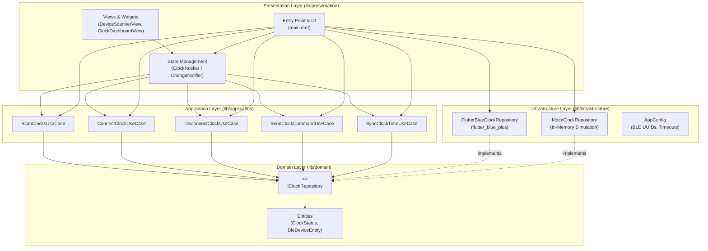

# BLE Smart Clock Controller (Clean Architecture)

Кросплатформний клієнтський застосунок на **Flutter/Dart** для керування та моніторингу розумного годинника на базі мікроконтролера ESP32-C3 через протокол **Bluetooth Low Energy (BLE)**.

Архітектура проєкту побудована за принципами **Clean Architecture (Чиста архітектура)** Роберта Мартіна з дотриманням принципів **SOLID** (зокрема Dependency Inversion Principle, DIP) та регламентованої стратегії гілкування **GitFlow**.

---

## 1. Предметна область (Domain)

**Предметна область:** Бездротове керування та моніторинг розумного електронного годинника (BLE Smart Clock).

### Основні можливості застосунку:
* **Сканування та виявлення BLE-пристроїв**: динамічний пошук та фільтрація доступних годинників в ефірі з відображенням рівня сигналу (RSSI).
* **Синхронізація системного часу**: надсилання точного часу та дати зі смартфона на RTC-модуль годинника в один клік.
* **Керування режимами дисплею**: перемикання відображення інформації (час, дата, температура, анімація).
* **Будильник, таймер та секундомір**: встановлення часу спрацювання будильника, запуск та зупинка зворотного відліку або секундоміра, моніторинг станів тривоги.
* **Моніторинг температури та сенсорів**: прийом телеметрії в реальному часі.
* **Автономний Mock-режим**: можливість повноцінно тестувати UI та логіку застосунку в емуляторі/браузері без наявності фізичного ESP32.

---

## 2. Схема архітектури застосунку (Clean Architecture)

Структура каталогів та залежностей чітко відповідає правилу залежностей: **зовнішні шари знають про внутрішні, але внутрішні шари (Domain, Application) нічого не знають про зовнішні (Infrastructure, Presentation)**.



### Опис шарів:

| Шар | Призначення | Файли / Компоненти |
| :--- | :--- | :--- |
| **Domain** | Ядро бізнес-логіки. Містить сутності та абстрактні контракти репозиторіїв. Не має залежностей від зовнішніх бібліотек і фреймворків. | `lib/domain/entities/clock_status.dart`<br/>`lib/domain/entities/ble_device_entity.dart`<br/>`lib/domain/interfaces/i_clock_repository.dart` |
| **Application** | Сценарії використання (Use Cases). Реалізує бізнес-процеси, викликаючи методи доменного інтерфейсу `IClockRepository` (Dependency Inversion). | `lib/application/usecases/scan_clocks_usecase.dart`<br/>`lib/application/usecases/connect_clock_usecase.dart`<br/>`lib/application/usecases/disconnect_clock_usecase.dart`<br/>`lib/application/usecases/send_clock_command_usecase.dart`<br/>`lib/application/usecases/sync_clock_time_usecase.dart` |
| **Infrastructure** | Технічні реалізації та доступ до зовнішніх пристроїв / API. Реалізує інтерфейси з Domain (BLE через `flutter_blue_plus` або in-memory емулятор). | `lib/infrastructure/repositories/flutter_blue_clock_repository.dart`<br/>`lib/infrastructure/repositories/mock_clock_repository.dart`<br/>`lib/infrastructure/config/app_config.dart` |
| **Presentation** | Користувацький інтерфейс, віджети та точка складання залежностей (DI). Відображає стан та передає дії користувача у Use Cases. | `lib/presentation/notifiers/clock_notifier.dart`<br/>`lib/presentation/views/`<br/>`lib/presentation/widgets/`<br/>`lib/main.dart` |

---

## 3. Принцип інверсії залежностей (DIP)

Сценарії використання (`Use Cases`) взаємодіють зі сховищем/пристроєм виключно через інтерфейс `IClockRepository`. 
Це гарантує, що:
1. Бізнес-логіка не залежить від версії Bluetooth-бібліотеки або апаратної платформи.
2. Для модульного тестування можна підставити `MockClockRepository` або `FakeClockRepository`, не змінюючи жодного рядка коду в `Application` чи `Domain`.
3. Конкретне зв'язування відбувається у точці входу `lib/main.dart`:
```dart
// Dependency Injection у main.dart:
final IClockRepository repository = isDemoMode
    ? MockClockRepository()
    : FlutterBlueClockRepository(config: config);

final scanUseCase = ScanClocksUseCase(repository);
final connectUseCase = ConnectClockUseCase(repository);
final disconnectUseCase = DisconnectClockUseCase(repository);
final sendCommandUseCase = SendClockCommandUseCase(repository);
final syncTimeUseCase = SyncClockTimeUseCase(repository);

final notifier = ClockNotifier(
  repository: repository,
  scanUseCase: scanUseCase,
  connectUseCase: connectUseCase,
  disconnectUseCase: disconnectUseCase,
  sendCommandUseCase: sendCommandUseCase,
  syncTimeUseCase: syncTimeUseCase,
);
```

---

## 4. Політика гілкування та історія розробки

У проєкті застосовано стратегію **GitFlow**:
* `main` — стабільний релізний код, готовий до продакшену (зафіксовано тег `v1.0.0`).
* `develop` — основна інтеграційна гілка розробки.
* `feature/*` — функціональні гілки під кожну задачу:
  * `feature/domain-layer` — розробка сутностей, бізнес-правил та доменного інтерфейсу (4 описових коміти).
  * `feature/application-layer` — реалізація сценаріїв використання (Use Cases) з дотриманням DIP.
  * `feature/infrastructure-layer` — реалізація `FlutterBlueClockRepository`, `MockClockRepository` та конфігурації.
  * `feature/infrastructure-config` — додаткова гілка для симуляції конфлікту конфігурації.
  * `feature/presentation-layer` — інтерфейс користувача, віджети стану та збирання DI.

### Конвенція комітів (Conventional Commits):
* `feat(...)`: нова функціональність шару.
* `test(...)`: модульні та інтеграційні тести.
* `refactor(...)`: виправлення зауважень код-рев'ю, оптимізація.
* `chore(...)`: конфігурація та налаштування оточення.
* `merge(...)`: злиття гілок та розв'язання конфліктів.

---

## 5. Моделювання та розв'язання конфлікту злиття (Merge Conflict)

Для виконання лабораторного завдання було змодельовано конфлікт у файлі `lib/infrastructure/config/app_config.dart`:
1. У гілці `develop` було внесено зміни у конфігурацію:
   ```dart
   this.scanTimeout = const Duration(seconds: 10),
   ```
2. У паралельній гілці `feature/infrastructure-config` було встановлено:
   ```dart
   this.scanTimeout = const Duration(seconds: 8),
   ```
3. При виконанні команди `git merge feature/infrastructure-config` Git зупинив операцію з повідомленням:
   ```text
   CONFLICT (content): Merge conflict in lib/infrastructure/config/app_config.dart
   Automatic merge failed; fix conflicts and then commit the result.
   ```
4. Конфлікт було розв'язано вручну: обрано оптимальний таймаут (10 секунд для надійного сканування BLE в шумному середовищі) та успішно зафіксовано комітом:
   ```bash
   git add lib/infrastructure/config/app_config.dart
   git commit -m "merge: розв'язано конфлікт конфігурації сховища даних"
   ```

---

## 6. Інструкція зі збірки, тестування та запуску

### Вимоги до оточення:
* **Flutter SDK**: `>=3.3.0` (Dart SDK `>=3.0.0`)
* **ОС**: Windows, macOS, Linux, Android або iOS

### 1. Клонування репозиторію та налаштування:
```bash
git clone <URL_ВАШОГО_РЕПОЗИТОРІЮ>
cd bluetoothLabs

# Перевірка налаштувань автора
git config --global user.name "kovtunyana4-art"
git config --global user.email "kovtunyana4@gmail.com"
```

### 2. Встановлення залежностей:
```bash
flutter pub get
```

### 3. Запуск автоматичних тестів:
У проєкті реалізовано повне покриття модульних тестів (Domain, Use Cases, Presentation, State Notifier):
```bash
flutter test
```
*Усі 12 unit/widget-тестів проходять успішно.*

### 4. Статичний аналіз коду:
```bash
flutter analyze
```
*Результат: `No issues found!`.*

### 5. Запуск застосунку:
* **Запуск у режимі емуляції/демо (Mock-режим, не потребує Bluetooth-модуля):**
  ```bash
  flutter run -d windows
  # або
  flutter run -d chrome
  ```
* **Запуск на фізичному Android/iOS пристрої для роботи зі справжнім годинником:**
  ```bash
  flutter run -d android
  ```
